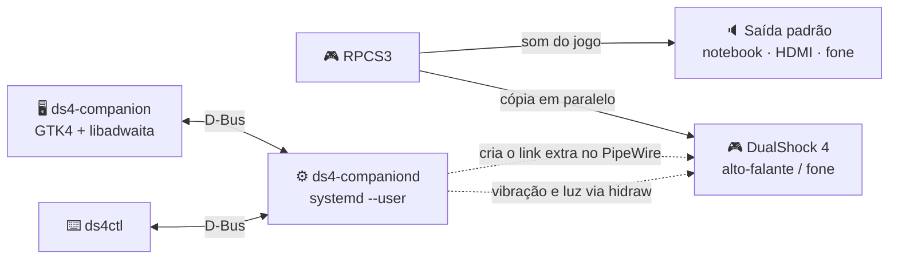

<div align="center">


# DS4 Companion

**O som do RPCS3 também no seu DualShock 4, sem trocar a saída de áudio.**<br>
Volume em dB com limite de segurança, força da vibração, cor da luz e suporte a cabo e Bluetooth.<br>
App nativo para Arch Linux, em GTK4 + libadwaita.

<a href="LICENSE"></a>


[Recursos](#-recursos) · [Como funciona](#-como-funciona) · [Instalação](#-instalação) · [Documentação](#-documentação) · [Roadmap](docs/desenvolvimento/ROADMAP.md) · [Contribuir](CONTRIBUTING.md)

</div>

---

> [!NOTE]
> **Status: documentação e planejamento.** Hoje o recurso funciona via scripts
> (`~/.local/bin/ds4-audio-mirror` + serviço systemd de usuário). Este projeto transforma isso em um app
> com interface gráfica, sem precisar do terminal.

## ✨ Recursos

| | Recurso | Cabo USB | Bluetooth |
|:-:|---|:-:|:-:|
| 🔊 | Som do jogo **em paralelo** no alto-falante/fone do controle | ✅ | ⚠️ [não suportado pelo Linux hoje](docs/guia/AUDIO.md#cabo-usb--bluetooth) |
| 🎚️ | Volume em dB com faixas verde/amarelo/vermelho e teto de segurança | ✅ | — |
| 📳 | Vibração: força dos motores forte e fraco, teste dos motores | ✅ | ✅ |
| 💡 | Cor da barra de luz, com cores pré-definidas *(planejado)* | ✅ | ✅ |
| 🔌 | Detecção automática cabo ↔ Bluetooth | ✅ | ✅ |
| 🔋 | Indicador de bateria | ✅ | ✅ |

**"Em paralelo"** quer dizer: a saída que você usa (notebook, monitor HDMI, fone de ouvido) **não muda**.
O controle recebe uma cópia do som do jogo ao mesmo tempo.
O juiz apita no jogo → apita na TV **e** no controle.

## 🧭 Como funciona



- **Sem saída virtual e sem trocar a saída padrão.** O daemon só liga as portas do RPCS3 também ao controle, então a latência é praticamente zero.
- **Tudo como usuário comum.** Root só na instalação, para a regra udev ([segurança](SECURITY.md)).
- **Protege o hardware.** O volume nunca passa do teto (padrão 0 dB) sem confirmação, e o teste de vibração dura no máximo 2 s.

Detalhes em [arquitetura](docs/arquitetura/ARCHITECTURE.md).

## 📦 Instalação

> [!IMPORTANT]
> O pacote ainda não existe. Os comandos abaixo mostram como vai ser.

```bash
git clone <repo> ds4-companion && cd ds4-companion/packaging
makepkg -si
systemctl --user enable --now ds4-companion.service
```

Depois, desconecte e reconecte o controle para a regra udev valer. Passo a passo, desinstalação e migração
dos scripts atuais em [instalação](docs/guia/INSTALL.md).

### Requisitos

- Arch Linux com GNOME (Wayland ou X11)
- PipeWire + WirePlumber (padrão no Arch)
- RPCS3 (`rpcs3-bin` ou AppImage)
- Regras udev para o DualShock 4 (instaladas pelo pacote)

## 🧱 Stack

Nativo do Arch Linux: só pacotes do repositório oficial (`extra`), instalado via `pacman`/AUR.
Sem Flatpak, Electron ou runtime embutido.

| Camada | Tecnologia | Pacote Arch |
|---|---|---|
| Linguagem | Python 3 | `python` |
| Interface | GTK4 + libadwaita (PyGObject) | `gtk4`, `libadwaita`, `python-gobject` |
| Fonte | Inter (OFL), substituta livre da SST | `inter-font` |
| Áudio | PipeWire + WirePlumber | `pipewire`, `wireplumber` |
| Controle (HID) | `hidraw` do kernel + udev | `python-pyudev` |
| Comunicação GUI ↔ daemon | D-Bus de sessão | `python-dbus-next` |
| Serviço em segundo plano | systemd de usuário | `systemd` |
| Empacotamento | PKGBUILD → AUR | `base-devel` |

Visual: preto + azul PlayStation, ícones só em SVG ([design](docs/design/DESIGN.md)).

## 📚 Documentação

Índice completo em [`docs/`](docs/README.md).

| | Para quem usa | | Para quem desenvolve |
|:-:|---|:-:|---|
| 📦 | [Instalação](docs/guia/INSTALL.md) | 🏗️ | [Arquitetura](docs/arquitetura/ARCHITECTURE.md) |
| ⚙️ | [Configuração](docs/guia/CONFIGURATION.md) | 🎨 | [Design](docs/design/DESIGN.md) · [Telas](docs/design/UI.md) |
| 🔊 | [Áudio](docs/guia/AUDIO.md) | ✅ | [Boas práticas](docs/desenvolvimento/BEST_PRACTICES.md) |
| 📳 | [Vibração](docs/guia/VIBRATION.md) | 🗺️ | [Roadmap](docs/desenvolvimento/ROADMAP.md) |
| 🩺 | [Solução de problemas](docs/guia/TROUBLESHOOTING.md) | 🤝 | [Contribuir](CONTRIBUTING.md) · [Changelog](CHANGELOG.md) |

## 🗺️ Roadmap

| Fase | Entrega | Status |
|---|---|:-:|
| 0 | Scripts: vibração no RPCS3 e áudio em paralelo por cabo | ✅ |
| 1 · v0.1 | Daemon + CLI `ds4ctl` | ⏳ |
| 2 · v0.2 | Interface gráfica, cor da luz e logo | ⏳ |
| 3 · v0.3 | PKGBUILD e AUR | ⏳ |
| 4 · v0.4+ | Limitador, perfis por jogo, DualSense | ⏳ |

Lista completa em [ROADMAP](docs/desenvolvimento/ROADMAP.md).

## 🤝 Contribuir

Issues e PRs são bem-vindos. Leia o [guia de contribuição](CONTRIBUTING.md) e o
[código de conduta](CODE_OF_CONDUCT.md). Vulnerabilidades vão pelo relato privado, não por issue
([SECURITY.md](SECURITY.md)).

## 📄 Licença

[GPL-3.0-or-later](LICENSE). Você pode usar, estudar, modificar e redistribuir; versões modificadas
distribuídas devem manter a mesma licença.

<sub>PlayStation, DualShock e PS4 são marcas da Sony Interactive Entertainment. Este projeto não é
afiliado, patrocinado nem endossado pela Sony.</sub>
