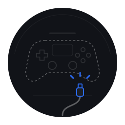
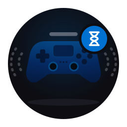
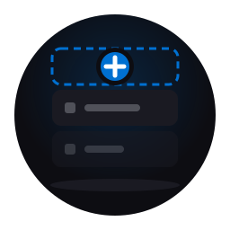
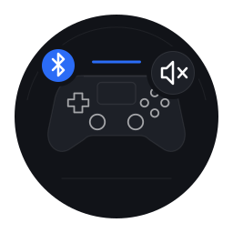
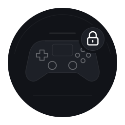
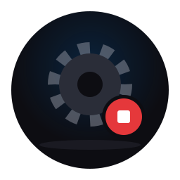
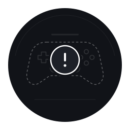
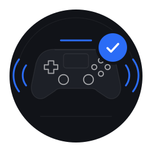

# Ilustrações

Ilustrações *flat* em SVG para as telas de estado: página vazia, erro, aviso e sucesso.
Ficam em [`data/illustrations/`](../../data/illustrations/). Cores e regras de SVG em [DESIGN.md](DESIGN.md).

## Regras

- **Nenhum texto dentro do SVG.** O texto fica na interface (título, descrição e botão), passa pelo
  `gettext` e pode ser traduzido. Isso vale para todas as ilustrações, inclusive as de erro.
- **A ilustração nunca aparece sozinha.** Toda tela de estado tem ao menos título e descrição que digam
  o que aconteceu e o que fazer. A ilustração reforça a mensagem; ela não a substitui.
- **Espaço pequeno = só texto.** Em barra lateral, popover ou cartão, usar `AdwStatusPage` com a classe
  `.compact` e sem ilustração.
- **Erro ≠ vazio.** Página vazia (nada configurado ainda) não usa sinal de alerta. O `!` só aparece
  quando algo de fato falhou.
- **Só as cinco cores do [DESIGN.md](DESIGN.md#paleta)** (`black-0/1/2`, `led-blue`, `white` com as
  opacidades de lá). Sem verde, amarelo ou vermelho: o tipo de estado vem do **símbolo**, não da cor.
- **Flat e slim:** sem gradiente, sem brilho, sem sombra. Profundidade por camada de preto;
  traços finos (≈1–1,5 px no tamanho de exibição), cantos arredondados.
- **Uma luz só:** `led-blue` marca o que está ativo ou o que o usuário deve fazer (a faixa de luz
  acesa, o plugue, o ＋). Todo o resto é preto e branco.
- **Formato:** `viewBox="0 0 256 256"` (1:1), sem fundo retangular, desenhado para a janela
  `black-0`. Exibir em 160–200 px. Sem `<image>`, sem script, sem fonte.
- **Mesmo controle do ícone do app**, para a interface parecer uma coisa só. Desenho próprio:
  sem logotipo da PlayStation e sem △◯✕□ (ver [Marca](DESIGN.md#marca)).

## Anatomia

Toda ilustração segue a mesma estrutura, de trás para frente:

1. **Fundo:** círculo `black-1` (r = 112), com a aresta superior em `white` 6% (a mesma luz batendo
   no material das superfícies elevadas) e uma linha de chão em `white` 8%.
2. **Objeto principal:**
   - controle **presente**: corpo `black-2`, borda `white` 8%, botões desenhados só em traço
     `white` 60%, **faixa de luz** de 2 px em `led-blue` acima dele;
   - controle **ausente ou inacessível**: contorno tracejado `white` 32%, faixa de luz apagada
     (`white` 8%);
   - engrenagem (serviço) ou cartões (listas) em `black-2`.
3. **Selo de estado:** círculo no canto superior direito, separado do objeto por um anel `black-1`.

| Selo | Fundo | Símbolos | Tipo |
|---|---|---|---|
| ativo | `led-blue` | ✓, ＋, Bluetooth | sucesso ou próxima ação |
| neutro | `black-2` + borda `white` 8% | ampulheta, cadeado, alto-falante mudo, ■ | espera, aviso, serviço parado |
| erro | `black-2` + anel `white` 2,5 px | ！ | algo falhou |

O selo de erro é o único com anel branco cheio: é o sinal mais forte que sobra sem cor de alerta,
e por isso não se repete em nenhum outro lugar das ilustrações.

## Catálogo

| Ilustração | Arquivo | Tipo | Quando aparece |
|:-:|---|---|---|
|  | `no-controller.svg` | vazio | Nenhum DualShock 4 detectado |
|  | `waiting-game.svg` | vazio | Controle ok, RPCS3 fechado |
|  | `empty-list.svg` | vazio | Lista sem itens (apps espelhados, perfis) |
|  | `bluetooth-no-audio.svg` | aviso | Página Áudio com o controle por Bluetooth |
|  | `no-permission.svg` | aviso | Sem acesso ao `hidraw` (regra udev não aplicada) |
|  | `service-stopped.svg` | erro | GUI não encontra o `ds4-companiond` no D-Bus |
|  | `error.svg` | erro | Falha inesperada sem tela própria |
|  | `all-set.svg` | sucesso | Fim da primeira configuração; tudo funcionando |

## Descrições e textos

Para cada ilustração: o que o desenho mostra, o texto alternativo (leitor de tela) e os textos da
tela. Os textos são o ponto de partida para o `gettext`.

### `no-controller.svg` — vazio
- **Desenho:** contorno tracejado de um controle (ausente), faixa de luz apagada e, embaixo, um cabo
  cinza com o plugue USB em `led-blue` solto e três traços azuis indicando onde conectar.
- **Texto alternativo:** "Controle desconectado"
- **Título:** Nenhum controle conectado
- **Descrição:** Ligue o DualShock 4 pelo cabo USB ou pareie por Bluetooth.
- **Botão:** Como parear (abre a ajuda)
- **Onde:** página Status.

### `waiting-game.svg` — vazio
- **Desenho:** controle presente com a faixa de luz acesa, ondas de som pontilhadas e apagadas dos dois
  lados (ainda sem som) e selo neutro com ampulheta.
- **Texto alternativo:** "Aguardando o jogo"
- **Título:** Aguardando o RPCS3
- **Descrição:** Abra um jogo no RPCS3 e o som vai para o controle automaticamente.
- **Botão:** nenhum.
- **Onde:** página Áudio, quando o espelhamento está ligado mas não há stream do RPCS3.

### `empty-list.svg` — vazio
- **Desenho:** dois cartões de lista apagados (o de baixo quase sumindo) e, acima, um cartão tracejado
  em `led-blue` com selo ＋ — o lugar do próximo item.
- **Texto alternativo:** "Lista vazia"
- **Título:** depende da lista: *Nenhum app extra* / *Nenhum perfil ainda*
- **Descrição:** *Só o RPCS3 vai para o controle. Adicione outros apps se quiser.* /
  *Crie um perfil para mudar volume e vibração por jogo.*
- **Botão:** ＋ Adicionar
- **Onde:** Áudio → Apps espelhados; Perfis (v0.4).

### `bluetooth-no-audio.svg` — aviso
- **Desenho:** controle presente com a faixa de luz acesa (vibração e luz funcionam), selo ativo de
  Bluetooth à esquerda e selo neutro com alto-falante mudo à direita.
- **Texto alternativo:** "Bluetooth sem áudio no controle"
- **Título:** Som no controle precisa do cabo
- **Descrição:** Por Bluetooth o Linux ainda não envia áudio para o DualShock 4. Vibração, luz e bateria
  continuam funcionando.
- **Botão:** Saiba mais (abre [AUDIO.md](../guia/AUDIO.md#cabo-usb--bluetooth))
- **Onde:** página Áudio, no lugar dos controles de volume.

### `no-permission.svg` — aviso
- **Desenho:** controle presente mas apagado (faixa de luz desligada, traços em `white` 32%) com selo
  neutro de cadeado.
- **Texto alternativo:** "Sem permissão"
- **Título:** Sem acesso ao controle
- **Descrição:** A regra de permissão ainda não valeu. Desconecte e conecte o controle de novo.
- **Botão:** Tentar de novo
- **Onde:** Status e Vibração, quando abrir o `hidraw` falha com `EACCES`.

### `service-stopped.svg` — erro
- **Desenho:** engrenagem `black-2` parada, eixo em traço `white` 32%, e selo neutro de "parar" (■).
- **Texto alternativo:** "Serviço parado"
- **Título:** Serviço parado
- **Descrição:** O ds4-companiond não está rodando, então o som e a vibração não são ajustados.
- **Botão:** Iniciar serviço (`systemctl --user start ds4-companion.service`)
- **Onde:** janela inteira, quando a GUI não acha o serviço no D-Bus.

### `error.svg` — erro
- **Desenho:** contorno tracejado de controle com o selo de erro (anel branco e ！) grande no centro.
- **Texto alternativo:** "Erro"
- **Título:** Algo deu errado
- **Descrição:** mensagem curta do erro, sem jargão. O detalhe técnico vai para o journal.
- **Botões:** Tentar de novo · Ver logs
- **Onde:** qualquer página, como último recurso.

### `all-set.svg` — sucesso
- **Desenho:** controle presente com a faixa de luz acesa, ondas de som em `led-blue` dos dois lados e
  selo ativo com ✓.
- **Texto alternativo:** "Tudo pronto"
- **Título:** Tudo pronto
- **Descrição:** O som do jogo vai tocar na sua saída de áudio e no controle ao mesmo tempo.
- **Botão:** Começar
- **Onde:** última tela da primeira configuração.

## Uso no GTK4/libadwaita

```python
page = Adw.StatusPage(
    paintable=Gtk.Svg.new_from_resource(  # vetorial: nítido em qualquer escala (GTK 4.22+)
        "/io/github/luizfelipe_pacifico/DS4Companion/illustrations/no-controller.svg"
    ),
    title=_("Nenhum controle conectado"),
    description=_("Ligue o DualShock 4 pelo cabo USB ou pareie por Bluetooth."),
)
```

- Implementado em `src/ds4_companion/app/states.py` (`status_page` e `inline_state`), carregando do
  GResource `data/ds4-companion.gresource.xml`.
- Tamanho: 176 px na tela cheia e 96 px dentro de uma página (`data/style.css`).
- O texto alternativo vai na descrição acessível da página.

## Nova ilustração

1. Copiar a ilustração mais parecida e trocar só o objeto e/ou o selo.
2. Usar só os tokens da [paleta](DESIGN.md#paleta).
3. Conferir sobre `black-0` em 96 px e em 200 px; nada pode depender de cor para ser entendido.
4. Otimizar com `scour` ou `svgo`.
5. Adicionar uma linha no catálogo e uma seção em *Descrições e textos*, no mesmo PR.

## Referências

- [libadwaita — AdwStatusPage](https://gnome.pages.gitlab.gnome.org/libadwaita/doc/main/class.StatusPage.html)
- [SAP Fiori — Designing for empty states](https://www.sap.com/design-system/fiori-design-web/v1-136/foundations/best-practices/global-patterns/designing-for-empty-states)
- [Primer — Empty states](https://primer.style/ui-patterns/empty-states)
- [Unity — Empty states](https://unityeditordesignsystem.unity.com/patterns/empty-states)
- [Dynatrace Barista — Empty states](https://barista.dynatrace.com/patterns/empty-states)
